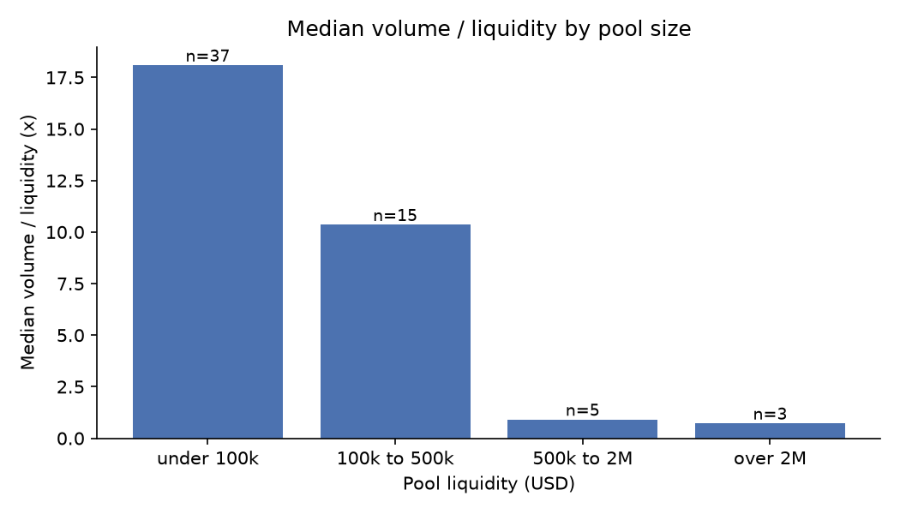

# Meteora Pool Efficiency

Quite a small Python pipeline that pulls in Meteora pool data from the GeckoTerminal API,
ranks pools by their capital efficiency (24h volume divided by liquidity) and tracks
how the ratio changes from day to day.

## How it works

- `fetch.py` requests up to 60 pools (3 pages) from the API, saves them to
  `meteora_data.json` and copies a timestamped snapshot into `history/`, though I initially started by requesting 20 pools (1 page) from the API.
- `main.py` reads the data, drops pools below a minimum liquidity, and prints a
  ranked table.
- `trend.py` reads every snapshot in `history/` and compares each pool's
  efficiency over time, matching pools by address.
- `history.py` holds the snapshot-copy function used by `fetch.py`.

## Run it

    pip install requests pytest
    python fetch.py
    python main.py
    python trend.py
    pytest

`trend.py` needs at least two snapshots that contain the same pool, so run
`fetch.py` on separate days before expecting output.

## The metric

Volume / liquidity shows how much trading a pool handles for each dollar of
capital in it. A high value suggests more fee potential for liquidity providers.
It is not profit: it ignores fee rates, impermanent loss and rewards.

## Choices I made

- **Minimum liquidity of \$100,000.** Small pools with a spike in volume kept climbing the rankings.
  I tested both \$50,000 and \$100,000 and stuck with the higher amount.
  A single cutoff number doesn't tell the whole story.
- **Matching pools by address.** Several pairs show up more than once with different results, so the name
  can't be trusted to identify the pool correctly.

## Data

Data comes from the GeckoTerminal API (DEX id `meteora`). I have not confirmed
that every pool returned is a DLMM pool, so I describe them as Meteora pools.
An early version ran on handwritten sample data. My first live attempt
failed because I called the GeckoTerminal website instead of the API.

## What I found

### Findings from 10th November 2026

- 25 of 60 pools passed the \$100,000 filter. MUSK / USDC ranked first at 15.43x
  with about \$106,800 of liquidity, just above the cutoff.
- The largest pools had low ratios. ANTFUN / USDT has about \$14.7M of liquidity
  and a 0.09x ratio.
- The same pair can be very different pools. One HYPE / SOL pool shows 10.74x
  and another 0.62x. I don't yet know why.
- This is one snapshot, so it shows no trend yet.

### Pool size and efficiency, 14th November 2026
- Efficiency dropped as pools got bigger. Under \$100k the median was 18.09x,
  and above \$500k it was under 1x. A few pools under \$100k are extreme, so the
  mean (115.24x) is far above the median there. That's part of why I use a
  \$100,000 cutoff. The two biggest bands have just 5 and 3 pools, so they're too
  small to trust. 
- I wondered why the mean for pools under \$100k was 115x when the median was
  only 18x. Five pools were behind it: each had under \$600 of liquidity but
  \$178k to \$450k of daily volume, which gives ratios between 308x and 780x.
  They're all well below my \$100,000 cutoff, so they never show up in the
  ranking. I don't know yet why they trade so much on so little liquidity.

- One snapshot from 14 November 2026. n is the number of pools in each band.

### Efficiency over time, 9 to 16 November 2026

One reading per day for the five pools I have readings for on the most days.

- STONK / SOL fell from about 4.5x to about 1.2x on the first day, then
  went down to about 0.6x.
- HYPE / SOL (6oQ9...6MK8) was the highest line on most days and peaked near
  17.7x on 15 November.
- WBTC / SOL started near 16x, then settled between about 7x and 10x.
- SPCX / SOL jumped to about 12.8x on 12 November and fell back the next day.
  That's a single day, so I'm not reading much into it.

## What I don't know yet

- I only have about a week of data, so nothing here is much of a proper trend.
- The volume figure covers a rolling 24 hours, and I take snapshots at
  different times of day, so day-to-day moves are a bit noisy.
- A pool drops out of the trend and the chart on any day its liquidity is under
  \$100,000.
- I can't tell yet whether a move comes from volume changing or liquidity
  changing.
- There's no fee, impermanent loss or reward data, so none of this says what a
  liquidity provider would actually earn.

## Next

- Save volume and liquidity next to efficiency, and plot them for STONK / SOL
  to see what's behind its fall.
- Add fee yield.
- Learn SQL with DuckDB and query the history with it.

## Tests

Run `pytest` to run all 11 tests. They cover the ranking, the liquidity filter,
the snapshot copy and the trend logic.

## Note on tools

I used AI assistants (Claude and Google AI) to review my code and help with
drafts. I made the decisions myself: the liquidity cutoff, matching pools by
address, which data to pull, and running the tests.
